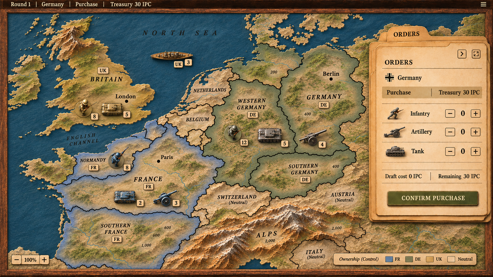

# Approved tabletop direction

Follow the [visual development worklist](VISUAL_WORKLIST.md) for the current
focus, review status and queued work.

This is the user's approved visual reference. Use it when reviewing actual game
captures. It specifies materials and art direction; its illustrative geography,
unit placements and values are not replacements for the rules data.

- Directly overhead camera, with dimensional terrain and pieces reacting to warm
  light and shadows. Crest-to-ground parallax must be visible during normal pans.
- A detailed physical survey-relief map, fine printed geography and readable ink
  labels. Territory centers show natural terrain; translucent ownership washes
  build toward the inside of borders.
- Layered manila folder and ivory document paper, period serif lettering,
  illustrated unit rows, printed rules and small paper quantity controls.
- Deep olive painted/brass primary actions, dark walnut surround and a slim
  unobtrusive information strip. Folder collapse and maximize are functional.
- Materials must have texture, edge highlights and contact shadows. Flat generic
  colored rectangles, rounded modern cards, Inter/Barlow UI and vector pictogram
  purchase rows do not satisfy this direction.

The folder, control and illustration textures in `game/art/ui` were generated
from this reference and are used by the actual Godot theme. Dynamic labels,
quantities and controls remain real accessible UI, not a baked screenshot.

## Implemented game captures

The current focused review is [1A — orders folder](orders-01/README.md).
The captures below retain the earlier broad implementation for comparison.

[Global 1940 interface](implemented-interface.png) ·
[World overview](implemented-world.png) · [Main menu](implemented-menu.png)

[Overhead terrain pan](overhead-pan.mp4) shows actual Godot-rendered frames from
a continuous middle-button drag. The frames were rendered offline and assembled
at 12 frames per second to make the spatial effect easy to compare; this is not
a real-time performance benchmark. The camera remains directly overhead.

The visual suite passes 170 checks, including terrain precision, continent
projection and picking, ownership updates, native folder controls, display
quality changes and a smaller viewport. At High detail, a 180-pixel pan gives
27.69 pixels of measured crest-to-ground parallax in the Himalayan test area.
Gameplay, save and LAN smoke checks also pass. These checks ran in Godot 4.7.2;
the capture machine uses software rendering. Target GPU and Android-device
performance still need hands-on testing.
